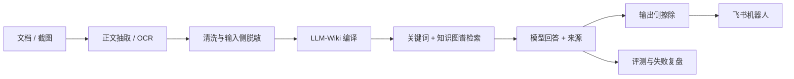

# 企业培训知识库问答助手

[](https://github.com/qiandewucimi-cpu/smart-qa-assistant/actions/workflows/public-release-check.yml)

**把分散的文档与截图整理为可检索知识，通过飞书回答业务问题，并保留来源与验证记录。**

基于 LLM-Wiki 的本地问答原型。公开仓库包含工程脚本、脱敏规则、离线验收与历史评测材料；企业原始资料、私有知识库实例和真实运行日志不公开。

[架构与演示](docs/架构与演示.md) · [评测证据](eval/README.md) · [完整复盘](docs/复盘报告.md) · [实验与运行详解](docs/实验与运行详解.md)

## 问题与我的贡献

培训资料、会议纪要和截图分散，新人需要反复翻找。我负责识别业务问题、定义知识范围与脱敏要求，以实际业务问法测试正常回答、多轮追问和语料外拒答，再根据失败推动术语对照、模型配置与交互入口迭代。代码使用 AI 开发工具辅助实现。

## 工作链路



历史评测实例使用关键词与知识图谱。向量索引虽已构建，查询期 embedding 因额度不足未生效；**不把向量检索计入历史效果归因**。恢复后必须重新 probe 和评测，配置开启不等于实际参与召回。

## 可以验证什么

| 入口 | 你能验证的内容 | 所需条件 |
|---|---|---|
| 公开离线验收 | 源码可编译、交付文件、历史评测规模与引用字段 | Python，无需模型与私有资料 |
| 单元测试 | 脱敏、输出擦除及核心脚本行为 | Python，无需在线服务 |
| 合成示例 | 受限规则提取与来源/拒答的接口示例 | 见 [合成示例说明](docs/合成示例.md)；不代表 LLM-Wiki 效果 |
| 在线问答 | 实际检索、模型回答和飞书链路 | 自行配置 LLM-Wiki、模型及获授权资料 |
| 历史报告 | 查阅已脱敏实验结果及归因 | 可公开阅读；原始语料未公开，不能完整复算原实验 |

## 快速验证

Python 3.11，在仓库根目录执行：

```bash
python scripts/project_acceptance.py
python -m unittest discover -s tests -v
python scripts/demo_synthetic.py
python scripts/check_public_release.py --include-untracked
```

以上命令不调用模型。完整运行环境、OCR、知识构建、模型配置和飞书接入见 [运行手册](docs/LLM_Wiki运行手册.md) 与 [详细流程](docs/实验与运行详解.md)。

## 历史结果与解释

以下为仓库中2026年9月实验记录，非当前线上监控或本次重新调用模型的成绩。

| 项目 | 历史记录 | 如何解读 |
|---|---|---|
| 资料处理 | 173份原始文件 → 121份清洗语料，119份去重来源 | 私有语料处理统计，公开仓库不能复算原文 |
| 主评测 | v1.0为19/21；v1.1两轮均18/21 | 共22题，1题因业务口径冲突不计分；不只报最好一次 |
| 拒答专项 | 语料外8/8拒答，语料内5/5作答 | 小样本专项，不能推断所有问题都正确 |
| 幻觉记录 | 主评测0/21，报告给出95%上界13.3% | “样本未观察到”不等于真实概率为零 |
| 延迟 | 一次基准P50从61.5s降至18.0s | 配置与样本限定，18s仍有交互等待成本 |

详情：[评测索引](eval/README.md)。扩展集“引用源页”指标衡量可追溯性，不等同于答案正确率。

## 关键取舍与已知问题

- 脱敏分布在输入、编译产物巡检、评测产物及机器人出站环节；规则检查通过只说明未命中已配置规则。
- 复杂对比/流程题曾受到工具迭代步数上限影响。续跑实验改变失败形态，未被计为已证实的命中率提升。
- 公开的离线验收核对工程与历史产物，不能证明在线回答质量、模型可用性或当前私有库规模。
- 原型尚未完成企业级生产部署、权限体系与服务可用性验收。

[历史实验与操作细节](docs/实验与运行详解.md) · [质量门槛与局限](docs/质量门槛对标.md) · [MIT License](LICENSE)
